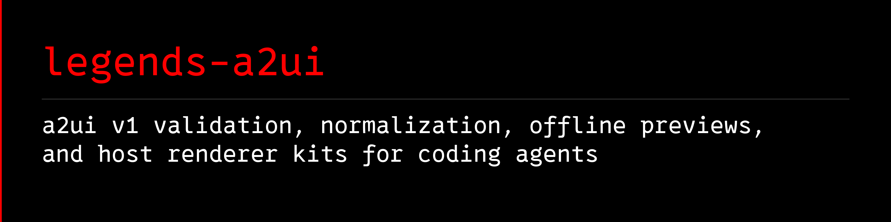
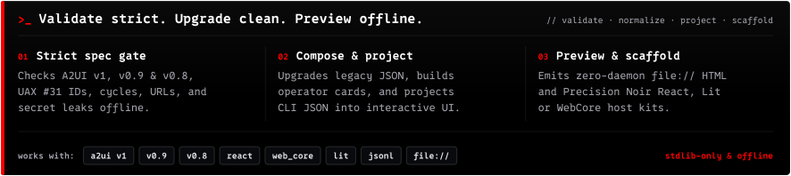
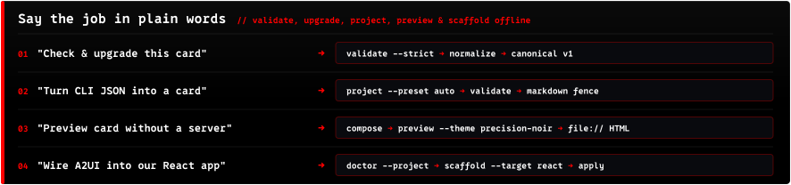
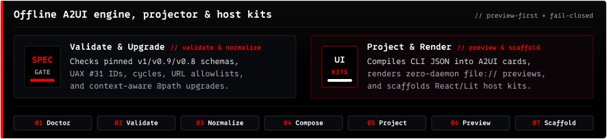
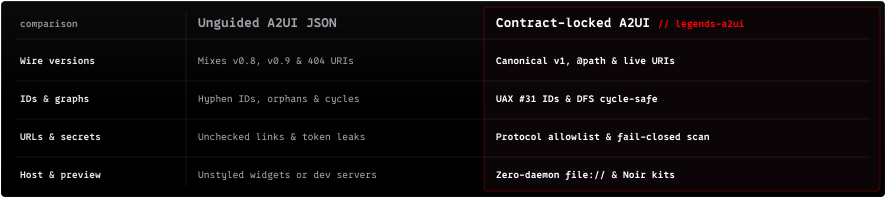

# 

[](https://github.com/avalonreset/legends-a2ui/releases/latest)
[](https://github.com/avalonreset/legends-a2ui/actions/workflows/checks.yml)
[](pyproject.toml)
[](vendor/a2ui-spec/manifest.json)
[](LICENSE)

**Offline-first A2UI validation, normalization, composition, JSON-to-surface projection, zero-daemon static HTML previewing, and Precision Noir host renderer scaffolding for coding agents, built strictly on the Python standard library with zero third-party pip dependencies.**


```text
Install or update legends-a2ui via cto-legends (https://github.com/avalonreset/cto-legends): run `cto-legends install legends-a2ui --apply`, then `cto-legends handoff legends-a2ui` and follow the returned JSON recipe to verify `legends-a2ui`.
```



## Why `legends-a2ui` exists

Prompting an unguided coding agent to emit interactive A2UI JSON or wire an `@a2ui/*` web renderer routinely breaks in six predictable ways:

1. **Silent protocol drift across `v0.8`, `v0.9`, `v0.9.1`, and `v1.0`:** Models mix v0.8 nested components (`beginRendering`, `surfaceUpdate`, `literalString`), v0.9 bare `{"path": "/x"}` / `{"call": "..."}` / `createSurface.theme` / `Text.variant: "h2"`, and v1.0 `@path` / `@call` / `@checks` syntax, or emit the broken HTTP 404 draft catalog URI (`v0_9/basic_catalog.json`) and omit `TextField.value` (now required in v1.0).
2. **Broken UAX #31 component IDs, dangling refs, and render cycles:** Hyphenated IDs (`submit-btn`), leading digits, missing `id: "root"`, dangling `child`/`tabs[].child` pointers, misplaced `weight` outside `Row`/`Column`, and cyclic graphs either crash host renderers or render blank frames.
3. **Unsafe URLs, ReDoS regexes, and accidental secret leaks:** Unchecked payloads pass `javascript:` or control-character-smuggled media/`openUrl` targets, catastrophic backtracking regexes in `@checks`, or raw API keys and JWTs straight into rendered operator cards.
4. **Unstyled default widgets and Light DOM CSS collisions:** `@a2ui/web_core` and `@a2ui/lit` inject Light DOM styles via `document.adoptedStyleSheets`, causing double-boxed root cards and mismatched defaults unless overridden cleanly alongside SSR-safe `setMarkdownRenderer` and a React `ErrorBoundary`.
5. **Terminal-only coding agents have no graphical A2UI host:** Agents working in headless terminals either dump raw JSON walls or try to spawn background localhost preview servers (violating endpoint safety), when operators actually need a single offline `file://` interactive HTML deck with live `dataModel` state and an Action Event Inspector.
6. **Cross-module UI bloat:** Every CLI tool emits structured JSON (`planSha256` previews, `doctor` health checks, briefings), yet hardcoding A2UI serializers into every module creates tight coupling. A zero-coupling `project` compiler turns any structured JSON into a strict-validated A2UI v1.0 surface on demand.

`legends-a2ui` solves all six locally, offline by default, with SHA-256-pinned official `a2ui-project/a2ui` schemas and preview-first (`planSha256`) write safety on every disk mutation.

## Ask in plain english

Once [`cto-legends`](https://github.com/avalonreset/cto-legends) is installed, ask your coding agent in plain english. It checks your runtime and vendored spec integrity, validates or upgrades legacy A2UI payloads, composes operator cards or projects CLI JSON, builds offline `file://` previews, and scaffolds host renderer kits preview-first:



## Architecture



### CLI surface

Every subcommand runs offline on Python 3.11+ standard library only (`dependencies = []`). Only `doctor --live` contacts the network, using HTTPS TLS 1.2+ with DNS IP pinning against a strict 4-host allowlist (`registry.npmjs.org`, `pypi.org`, `api.github.com`, `a2ui.org`).

| Surface | `legends-a2ui` Subcommand | What It Does |
| :--- | :--- | :--- |
| **Runtime & Drift Doctor** | `doctor` | Checks Python, optional Node and Playwright, SHA-256 integrity of vendored specs and the knowledge pack, optional read-only `--project <dir>` `@a2ui/*` / 404-URI / v0.8 drift scan, and optional `--live` upstream probe. |
| **Strict Offline Validator** | `validate` | Validates JSON objects, arrays, `{"messages": [...]}` wrappers, JSONL, and Markdown `--extract-markdown` fences against vendored schemas, UAX #31 IDs, component graph cycles/orphans/dangling refs, Basic Catalog rules, media/`openUrl` allowlists, CWE-400 bounds, and secret-leak refusal. |
| **Deterministic Normalizer** | `normalize` | Upgrades `v0.8`, `v0.9`, `v0.9.1`, and draft `v1.0` payloads into strict canonical `v1.0` (context-aware `@path`/`@call`, unprefixed `ChildList.path` and `updateDataModel.path`, Markdown heading migration, UAX #31 ID remapping, canonical `catalogId`). |
| **Operator Surface Composer** | `compose` | Emits strict-validated A2UI v1.0 surfaces from curated templates (`ship-call`, `choice-picker`, `intake-form`, `tabbed-briefing`, `status-dashboard`, `confirm-action`, `media-review`, `wizard-step`) via `--list`, `--template`, `--vars`, or `--vars-file`. |
| **Zero-Coupling Projector** | `project` | Compiles arbitrary structured JSON (`--input <path\|->`) into strict A2UI v1.0 surfaces via `--preset auto\|plan-approval\|health-deck\|data-briefing` without coupling upstream CLI tools to A2UI. |
| **Zero-Daemon Static Preview** | `preview` | Renders a single self-contained, zero-CDN `file://` HTML5 app (preview-first `planSha256`) with strict CSP, RFC 8259 `\u003c`/`\u003e`/`\u0026` JSON Unicode escaping, Precision Noir dark and Light themes, all Basic Catalog components, reactive `dataModel`, and an Action Event Inspector. |
| **Host Renderer Scaffolder** | `scaffold` | Previews (`planSha256`) and generates TypeScript + Light DOM CSS integration kits for `--target react\|web-core\|lit` (`precision-noir` or `neutral` theme) with canonical catalog URIs, `ErrorBoundary`, and URL safety helpers. |
| **Offline Catalog Inspector** | `catalog` | Queries vendored official Basic and Standard Catalog components and built-in functions across `1.0`, `0.9.1`, `0.9`, and `0.8` offline (`--list`, `--component`, `--function`). |
| **Offline Spec & Wiki Search** | `docs-lookup` | Searches SHA-256-pinned `a2ui-project/a2ui` specification docs and local `wiki/` runbooks offline, with optional `--live-locations` links to `a2ui.org` and GitHub. |
| **Empire Knowledge Pack** | `knowledge-pack` | Verifies `knowledge/a2ui/pack.json` (`legends.knowledge-pack/v1`) SHA-256 digests (`--check`) and outputs the `legends-empire` attachment command. |
| **Packaged Resource Resolver** | `resources` | Prints resolved checkout or wheel `package_data` paths (`recipe`, `pack_manifest`, `vendor_manifest`, `wiki`) as JSON. |

## Unguided JSON vs `legends-a2ui`



## Quick start

```sh
# 1. Verify Python runtime, vendored A2UI spec SHA-256 manifest, and knowledge pack offline
legends-a2ui doctor --json

# 2. Validate every fenced ```a2ui block in a Markdown reply under strict A2UI v1.0 rules
legends-a2ui validate --input reply.md --extract-markdown --version 1.0 --strict --json

# 3. Deterministically upgrade a legacy v0.8 or v0.9 payload to canonical A2UI v1.0
legends-a2ui normalize --input legacy.json --target 1.0 --format json

# 4. Compose a strict-validated operator surface from curated templates
legends-a2ui compose --list
legends-a2ui compose --template ship-call --vars '{"title":"Ship Release","target":"main"}' --format markdown-fence

# 5. Project any structured CLI JSON (for example a preview plan or doctor report) into an interactive surface
legends-a2ui doctor --json | legends-a2ui project --input - --preset auto --format markdown-fence

# 6. Render an offline, zero-daemon file:// HTML preview (two-step preview -> apply)
legends-a2ui preview --input surface.json --output ./preview-surface.html --theme precision-noir --json
legends-a2ui preview --input surface.json --output ./preview-surface.html --theme precision-noir --apply --confirm-plan <planSha256> --json

# 7. Scaffold a React, WebCore, or Lit Precision Noir host integration kit (two-step preview -> apply)
legends-a2ui scaffold --target react --output ./src/a2ui --theme precision-noir --json
legends-a2ui scaffold --target react --output ./src/a2ui --theme precision-noir --apply --confirm-plan <planSha256> --json

# 8. Query Basic Catalog schemas and search vendored A2UI docs offline
legends-a2ui catalog --component TextField --version 1.0 --json
legends-a2ui docs-lookup "Checkable @checks" --version 1.0 --live-locations --json
```

## Reference

<details>
<summary><strong>Knowledge vault runbooks and <code>legends-empire</code> attachment (<code>knowledge-pack</code>)</strong></summary>

Start at [wiki/index.md](wiki/index.md) or attach the versioned knowledge pack at [knowledge/a2ui/pack.json](knowledge/a2ui/pack.json) (`legends.knowledge-pack/v1`):

- [Wiki index](wiki/index.md)
- [Wire format and version drift (`v0.8` / `v0.9` / `v1.0`)](wiki/wire-format-and-drift.md)
- [Basic Catalog component and function reference](wiki/basic-catalog-reference.md)
- [React, WebCore, and Lit host integration](wiki/react-and-lit-integration.md)
- [Security, validation, and EDR guardrails](wiki/security-and-validation.md)
- [Streaming formats, Markdown extraction, and actions](wiki/streaming-and-actions.md)
- [Ecosystem projection (`project`) and offline preview (`preview`)](wiki/ecosystem-projection-and-preview.md)
- [Pinned upstream sources](references/sources.md), [Surface receipt template](templates/surface-receipt.md), and [Empire attachment guide](docs/EMPIRE.md)

```sh
legends-a2ui knowledge-pack --check --json
legends-a2ui resources --json
cto-legends run legends-empire -- knowledge attach /path/to/legends-a2ui/knowledge/a2ui/pack.json --vault /path/to/vault
```

</details>

<details>
<summary><strong>Vendored official A2UI specifications and offline lookup</strong></summary>

`legends-a2ui` pins official `a2ui-project/a2ui` (`google/A2UI`) JSON schemas, Basic and Standard Catalogs, `versions.json`, and protocol Markdown guides under `vendor/a2ui-spec/` with SHA-256 verification in [vendor/a2ui-spec/manifest.json](vendor/a2ui-spec/manifest.json).

- Canonical v1.0 Basic Catalog URI: `https://a2ui.org/specification/v1_0/catalogs/basic/catalog.json`
- Canonical v0.9 Basic Catalog URI: `https://a2ui.org/specification/v0_9/catalogs/basic/catalog.json`
- Canonical v0.8 Standard Catalog URI: `https://a2ui.org/specification/v0_8/standard_catalog_definition.json`
- Official machine-readable index: `https://a2ui.org/llms.txt`

Query schemas and docs offline with `legends-a2ui catalog` and `legends-a2ui docs-lookup`, or inspect project package drift against upstream with `legends-a2ui doctor --project <dir> --live --json`.

</details>

<details>
<summary><strong>Agent setup (via <code>cto-legends</code>), EDR guardrails, and standalone install</strong></summary>

Part of [`cto-legends`](https://github.com/avalonreset/cto-legends). The central router skill is vendored at [skills/cto-legends/SKILL.md](skills/cto-legends/SKILL.md); this module does not register a separate host skill or require an ambient MCP daemon.

Run `cto-legends handoff legends-a2ui` and follow [docs/AGENT-RECIPE.md](docs/AGENT-RECIPE.md).

```sh
# Via cto-legends
cto-legends handoff legends-a2ui
cto-legends run legends-a2ui -- doctor --json

# Or standalone from source
git clone https://github.com/avalonreset/legends-a2ui.git
cd legends-a2ui
python -m pip install .
legends-a2ui doctor --json
```

**EDR and Security Guardrails (Laws 1-6):**
- Zero hidden shell wrappers or execution-policy bypass launchers.
- Zero browser profile, cookie store, or OS credential store reads (`doctor --project` skips `.env*`).
- Zero secret echoing; live token patterns are detected and refused fail-closed.
- Preview-first `planSha256` confirmation, symlink/reparse refusal, base-directory containment, Windows Controlled Folder Access path protection, and atomic no-clobber writes on all disk mutations.
- Zero localhost preview daemons (`preview` emits static offline `file://` HTML under a strict CSP).
- 100% doc-to-CLI parity and HTTPS-only DNS-pinned allowlist for optional `doctor --live`.

</details>

<details>
<summary><strong>Attribution and scope boundaries</strong></summary>

`legends-a2ui` is an independent MIT-licensed module built around the official A2UI specifications and catalogs and is not affiliated with or endorsed by Google LLC or the A2UI project. Vendored specification files under `vendor/a2ui-spec/` are licensed under Apache-2.0; see [THIRD_PARTY_NOTICES.md](THIRD_PARTY_NOTICES.md), [vendor/a2ui-spec/NOTICE](vendor/a2ui-spec/NOTICE), and [vendor/a2ui-spec/LICENSE](vendor/a2ui-spec/LICENSE).

This module does not host live multi-tenant agent backends, provision cloud infrastructure, bypass URL or secret safety gates, or spawn background preview servers.

</details>

## Contributing, security, and license

See [compatibility and verification](docs/RELEASE-READINESS.md), [capabilities](CAPABILITIES.md), [contributing](CONTRIBUTING.md), [code of conduct](CODE_OF_CONDUCT.md), [security](SECURITY.md), [support](SUPPORT.md), and [attribution](THIRD_PARTY_NOTICES.md).

MIT License. See [LICENSE](LICENSE) and [THIRD_PARTY_NOTICES.md](THIRD_PARTY_NOTICES.md).

## Start here

Paste the [agent handoff block](#top) at the top of this page into your coding agent, let it wire the `cto-legends` router skill, and speak your task in plain English.

Running a company and not a terminal? Founders and operators who want this way of working applied directly to their own business stack have one route: message Avalon Reset at [cto-legends.com/dm](https://cto-legends.com/dm) or start with a 48-hour diagnostic at [cto-legends.com/home#home-offer](https://cto-legends.com/home#home-offer). The desk is async, so the conversation starts the moment you write and nobody forces you onto a sales call.

<p align="center"><a href="https://cto-legends.com/dm"></a></p>

<p align="center"><a href="https://github.com/stars/avalonreset/lists/cto-legends"></a></p>

**Specification & benchmarks on cto-legends.com:**
- **Module specification & architecture matrix:** [cto-legends.com/modules/legends-a2ui](https://cto-legends.com/modules/legends-a2ui)
- **Related engineering dispatches:** [How to Choose MCP vs CLI Tools Without Context Bloat](https://cto-legends.com/blog?post=mcp-vs-cli) · [How to Vet an AI Implementation Consultant in 15 Minutes](https://cto-legends.com/blog?post=ai-implementation-consultant)
- **Ecosystem hub:** [cto-legends.com/home](https://cto-legends.com/home)
